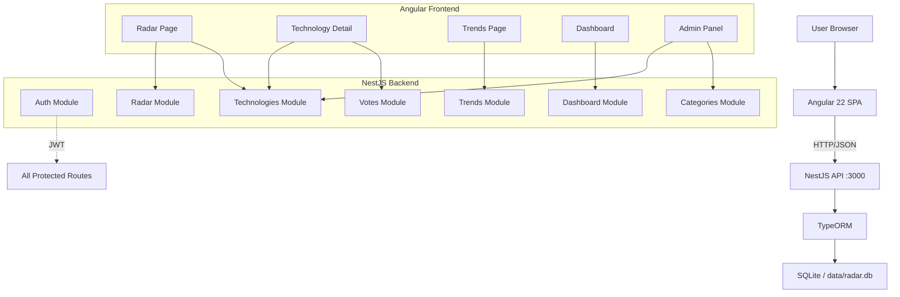

# Architecture

## System Overview

Tech Radar follows a classic two-tier architecture: an Angular SPA communicates with a NestJS REST API over HTTP. Data is persisted in SQLite (development) with a PostgreSQL-compatible schema.

## Data Flow

1. **Read operations** (public): Radar chart, technology list, trends — no auth needed
2. **Write operations** (protected): Votes require JWT, admin operations require admin role
3. **Vote flow**: User submits vote → NestJS validates → TypeORM upserts → avgScore/voteCount auto-recalculated → Radar updated
4. **Trend computation**: On request, backend queries votes grouped by technology and period, compares current vs previous period averages

## Design Decisions

### Why SQLite for development?
- Zero configuration, file-based, perfect for local development
- TypeORM abstracts the database layer — SQLite ↔ PostgreSQL migration is straightforward
- `synchronize: true` enables rapid schema iteration during development

### Why denormalized avgScore/voteCount?
- Avoids expensive JOINs on every radar chart render
- Updated synchronously in VoteService after each vote mutation
- Keeps the radar endpoint fast (< 50ms response)

### Why SVG radar chart (not Chart.js)?
- Lighter bundle (no external chart library dependency)
- Full control over rendering and interaction
- Better accessibility with SVG titles/descriptions
